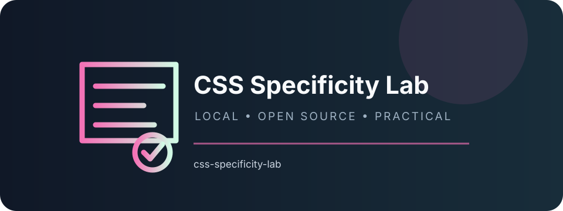

<p align="center"></p>
<p align="center"></p>
<p align="center">   </p>
<p align="center"></p>

## 🧭 Overview
CSS Specificity Lab explains the ID, class, and type components of a selector and compares two selectors lexicographically. It runs locally and does not contact external services.

## ✨ Features
- 🎯 Calculates specificity as (IDs, classes, types).
- 🧩 Handles :where(), :is(), :not(), and :has() using their specificity rules.
- ⚖️ Compares two selectors and explains the winner.
- 🔒 Runs in your browser with a tiny Node.js static server.

## 🎬 Demo
```text
Selector A: #app .card h2  →  (1, 1, 1)
Selector B: main .card h2   →  (0, 1, 2)
Winner: Selector A
```
The example runs locally; no hosted service is required.

## 🚀 Quick Start
```bash
npm install
npm start
```
Open the local address printed by the server (default: http://127.0.0.1:4173).

## 🧰 Tech Stack
- Node.js 18+
- HTML, CSS, and browser JavaScript
- Node's built-in test runner

## 🗂️ Folder Structure
```text
server.js
public/index.html
public/app.js
public/specificity.js
public/styles.css
tests/specificity.test.js
package.json
assets/overview.svg
```

## 🗺️ Roadmap
- [x] Core local workflow
- [x] Documented interface
- [ ] Broader edge-case coverage
- [ ] Optional CI examples

## 🤝 Contributing
Issues and focused pull requests are welcome. Add regression tests for bug fixes and document new behavior.

## 📄 License
Released under the [MIT License](LICENSE).

<p align="center"></p>
